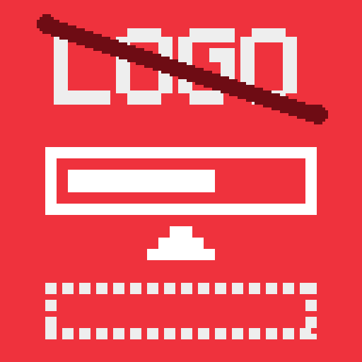
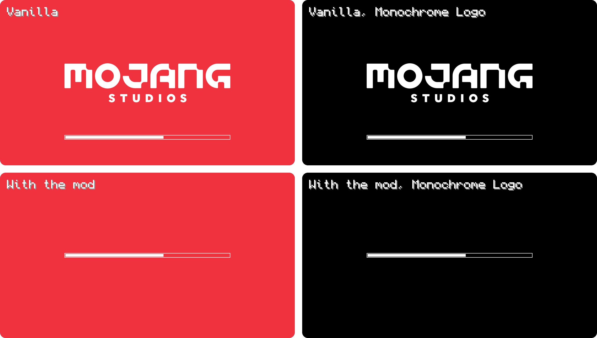

# Centered Loading Bar

A small Fabric mod for Minecraft 26.3 that cleans up the loading screen: the Mojang Studios logo
is gone and the loading bar sits in the middle of the screen, where the logo used to be, instead
of alone near the bottom. It only changes how the loading screen looks — nothing in the game
itself.

*[Po polsku niżej.](#po-polsku)*

<p></p>



Tested on a MacBook Air M1 with Minecraft 26.3 and Fabric Loader 0.19.5, October 2026; the
screenshots above are taken in the game.

## Install

1. Have a Minecraft 26.3 profile with [Fabric Loader](https://fabricmc.net/use/) — in the
   Modrinth App or Prism Launcher, just pick Fabric when creating the profile.
2. Get the mod from [Modrinth](https://modrinth.com/mod/clb): in the Modrinth App search for
   **Centered Loading Bar** and click **Install**, or download the `.jar` and put it in the
   profile's `mods` folder.
3. Start the game. There is nothing to set up.

## Good to know

- **Fabric API is not needed.** The mod uses only Fabric Loader, so it adds nothing else to the
  profile.
- **It works on every loading screen** — when the game starts and when resources reload (changing
  resource packs, F3+T).
- **The Monochrome Logo option works too.** With Accessibility → Monochrome Logo on, the screen is
  black instead of red; the logo is still hidden and the bar still centred.
- **It gets along with [Reimagined Intro](https://modrinth.com/mod/reimagined-intro).** Both can be
  installed at once.
- **Client-side only.** Servers don't need it and don't notice it.
- **A future Minecraft update won't crash the game because of it.** If Mojang changes the loading
  screen, the mod simply stops doing anything until it's updated.

## Building

Gradle needs a JDK 17 or newer to start and downloads JDK 25 for the build by itself:

```
./gradlew build
```

The mod ends up in `build/libs/`.

## Publishing to Modrinth

Bump `version` in `gradle.properties`, then:

```
CHANGELOG="what changed" ./gradlew build modrinth
```

The token is read from `MODRINTH_TOKEN`, or else from `~/.config/modrinth/token`; it needs the
Create versions, Read versions and Write versions scopes. After the upload the version is marked
client-only by itself. Add `-PmodrinthDebug` to see what would be uploaded without uploading it.

## License

MIT, see [LICENSE](LICENSE).

Not an official Minecraft product. Not approved by or associated with Mojang or Microsoft.

---

## Po polsku

Mały mod Fabric do Minecrafta 26.3, który porządkuje ekran ładowania: logo Mojang Studios znika,
a pasek ładowania stoi na środku ekranu, tam gdzie było logo, zamiast samotnie przy dolnej
krawędzi. Zmienia tylko wygląd ekranu ładowania — nic w samej grze.

Instalacja: profil Minecraft 26.3 z [Fabric Loaderem](https://fabricmc.net/use/) (w Modrinth App
albo Prism Launcherze wystarczy wybrać Fabric przy tworzeniu profilu), potem mod z
[Modrinth](https://modrinth.com/mod/clb) — w Modrinth App wyszukaj **Centered Loading Bar**
i kliknij **Install** albo wrzuć pobrany plik `.jar` do folderu `mods`. Niczego nie trzeba
ustawiać.

- **Fabric API nie jest potrzebne** — wystarczy sam Fabric Loader.
- **Działa na każdym ekranie ładowania** — przy starcie gry i przy przeładowaniu zasobów (zmiana
  paczek, F3+T).
- **Działa z opcją Monochromatyczne logo** (Ułatwienia dostępu) — tło jest wtedy czarne, logo dalej
  schowane, pasek dalej na środku.
- **Dogaduje się z [Reimagined Intro](https://modrinth.com/mod/reimagined-intro)** — oba mogą być
  zainstalowane naraz.
- **Tylko po stronie klienta** — serwer go nie potrzebuje.
- **Aktualizacja Minecrafta nie wysypie przez niego gry** — jeśli Mojang zmieni ekran ładowania,
  mod po prostu przestanie działać, dopóki nie dostanie aktualizacji.

Licencja MIT. To nie jest oficjalny produkt Minecraft; nie jest zatwierdzony przez Mojang ani
Microsoft ani z nimi powiązany.
